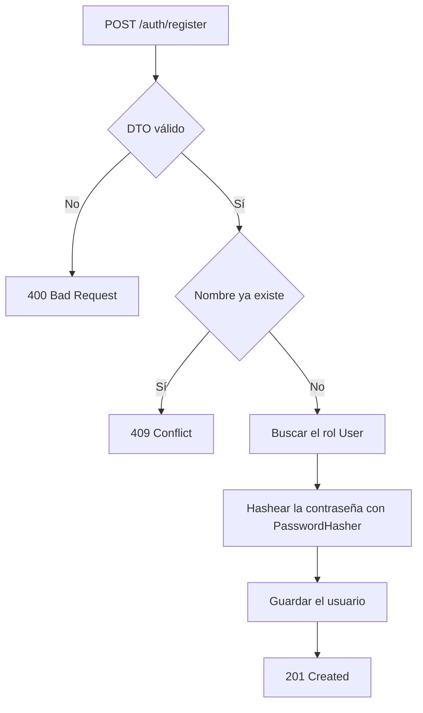
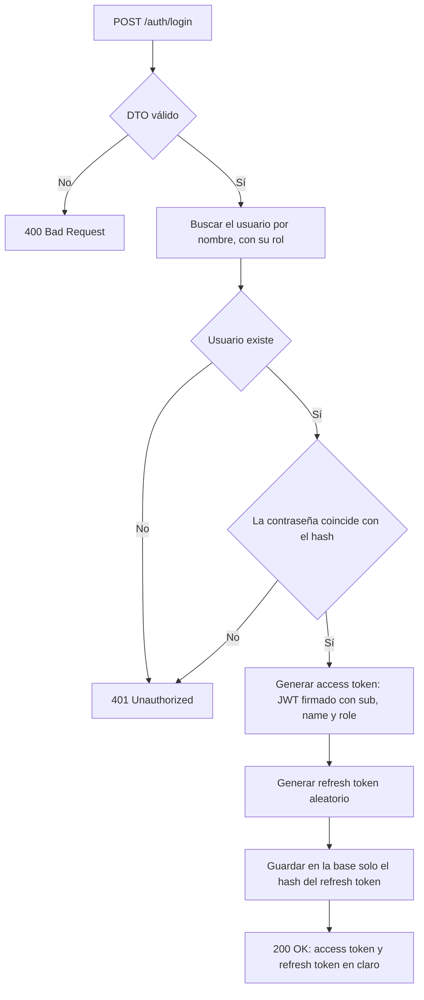
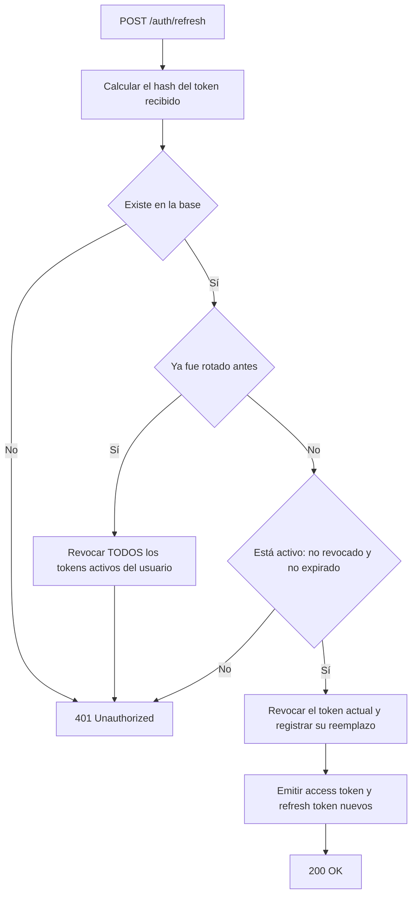

# JwtAuth

API de autenticación y autorización con **JWT** en **ASP.NET Core (.NET 10)**, con controladores, EF Core y SQLite. Proyecto de aprendizaje: este documento explica, paso a paso, cómo construirlo desde cero mostrando cada archivo, clase y configuración.

## Qué hace

- Registro de usuarios (`POST /auth/register`) con la contraseña hasheada.
- Login (`POST /auth/login`) que devuelve un **access token** (JWT, 15 min) y un **refresh token** (aleatorio, 7 días).
- Renovación (`POST /auth/refresh`) con **rotación** y **detección de reutilización**.
- Logout (`POST /auth/logout`) que revoca el refresh token.
- Endpoints protegidos con **roles** y **políticas** (`/me`, `/users`).

## Índice

0. [Requisitos](#0-requisitos)
1. [Crear el proyecto](#1-crear-el-proyecto)
2. [Instalar los paquetes](#2-instalar-los-paquetes)
3. [Base de datos (database first)](#3-base-de-datos-database-first)
4. [Configuración del JWT](#4-configuración-del-jwt)
5. [DTOs](#5-dtos)
6. [TokenService](#6-tokenservice)
7. [Registro, login, refresh y logout](#7-registro-login-refresh-y-logout)
8. [Validación del token (middleware)](#8-validación-del-token-middleware)
9. [Autorización: roles y políticas](#9-autorización-roles-y-políticas)
10. [Endpoints protegidos](#10-endpoints-protegidos)
11. [Pruebas](#11-pruebas)
12. [Referencia de endpoints](#12-referencia-de-endpoints)
13. [Notas de seguridad](#13-notas-de-seguridad)

## Estructura final

```text
JwtAuth/
├── Authorization/
│   └── Policies.cs
├── Controllers/
│   ├── AuthController.cs
│   ├── MeController.cs
│   └── UsersController.cs
├── Data/
│   └── AppDbContext.cs            (generado por scaffold)
├── Database/
│   └── schema.sql
├── Dtos/
│   └── AuthDtos.cs
├── Models/
│   ├── Role.cs                    (generado por scaffold)
│   ├── User.cs                    (generado por scaffold)
│   ├── RefreshToken.cs            (generado por scaffold)
│   └── RefreshToken.Partial.cs
├── Options/
│   └── JwtSettings.cs
├── Services/
│   └── TokenService.cs
├── appsettings.json
├── http-client.env.json
├── requests.http
├── JwtAuth.csproj
└── Program.cs
```

---

## 0. Requisitos

- [.NET 10 SDK](https://dotnet.microsoft.com/download)
- Herramienta de EF Core: `dotnet tool install --global dotnet-ef`
- `sqlite3` en el `PATH` (para crear la base desde el script SQL)
- Un cliente HTTP (el archivo `requests.http` usa el de Rider; también sirve `curl`)

## 1. Crear el proyecto

```powershell
dotnet new web -n JwtAuth
cd JwtAuth
```

La plantilla `web` crea un proyecto `Microsoft.NET.Sdk.Web` con un `Program.cs` mínimo ("Hello World"). Al final del paso 2 el `.csproj` queda así:

```xml
<Project Sdk="Microsoft.NET.Sdk.Web">

  <PropertyGroup>
    <TargetFramework>net10.0</TargetFramework>
    <Nullable>enable</Nullable>
    <ImplicitUsings>enable</ImplicitUsings>
    <UserSecretsId>78ad7744-0dea-4d47-b26a-bdf0a8d388cd</UserSecretsId>
  </PropertyGroup>

  <ItemGroup>
    <PackageReference Include="Microsoft.AspNetCore.Authentication.JwtBearer" Version="10.0.14" />
    <PackageReference Include="Microsoft.EntityFrameworkCore.Design" Version="10.0.14">
      <IncludeAssets>runtime; build; native; contentfiles; analyzers; buildtransitive</IncludeAssets>
      <PrivateAssets>all</PrivateAssets>
    </PackageReference>
    <PackageReference Include="Microsoft.EntityFrameworkCore.Sqlite" Version="10.0.14" />
  </ItemGroup>

</Project>
```

- `Nullable` activa el análisis de nulabilidad (por eso las propiedades `string` se inicializan).
- `ImplicitUsings` evita escribir los `using` más comunes (`System`, `System.Linq`, `Microsoft.AspNetCore.Http`, etc.).
- `UserSecretsId` lo agrega `dotnet user-secrets init` (paso 4).

## 2. Instalar los paquetes

```powershell
dotnet add package Microsoft.AspNetCore.Authentication.JwtBearer
dotnet add package Microsoft.EntityFrameworkCore.Sqlite
dotnet add package Microsoft.EntityFrameworkCore.Design
```

| Paquete | Para qué |
|---|---|
| `Microsoft.AspNetCore.Authentication.JwtBearer` | Middleware que valida el JWT (`AddJwtBearer`). Trae las librerías para crear tokens. |
| `Microsoft.EntityFrameworkCore.Sqlite` | Proveedor de EF Core para SQLite. |
| `Microsoft.EntityFrameworkCore.Design` | Permite a `dotnet ef` generar las clases desde la base (scaffold). |

La autorización (`[Authorize]`, políticas) y el hasheo de contraseñas (`PasswordHasher`) ya vienen en el framework.

## 3. Base de datos (database first)

El esquema vive en un script SQL y EF Core genera las clases leyendo la base.

### 3.1 Script del esquema

`Database/schema.sql`

```sql
PRAGMA foreign_keys = ON;

CREATE TABLE Role (
    Id          INTEGER PRIMARY KEY AUTOINCREMENT,
    Description TEXT NOT NULL UNIQUE
);

CREATE TABLE User (
    Id           INTEGER PRIMARY KEY AUTOINCREMENT,
    Name         TEXT    NOT NULL UNIQUE,
    PasswordHash TEXT    NOT NULL,
    RoleId       INTEGER NOT NULL REFERENCES Role(Id)
);

CREATE TABLE RefreshToken (
    Id                  INTEGER PRIMARY KEY AUTOINCREMENT,
    -- Hash del token (nunca el token en claro).
    TokenHash           TEXT    NOT NULL UNIQUE,
    UserId              INTEGER NOT NULL REFERENCES User(Id) ON DELETE CASCADE,
    CreatedAt           DATETIME    NOT NULL,
    ExpiresAt           DATETIME    NOT NULL,
    -- NULL mientras el token siga activo.
    RevokedAt           DATETIME    NULL,
    -- Hash del token que lo reemplazó al rotar.
    ReplacedByTokenHash TEXT    NULL
);

CREATE INDEX IX_User_RoleId         ON User(RoleId);
CREATE INDEX IX_RefreshToken_UserId ON RefreshToken(UserId);

-- Datos iniciales
INSERT INTO Role (Description) VALUES ('Admin'), ('User');
```

- Las tablas van en **singular** para que las clases generadas se llamen `User`, `Role`, `RefreshToken`.
- Las fechas se declaran `DATETIME` (SQLite no tiene tipo fecha propio; con `TEXT`, EF generaría `string`).
- `PasswordHash` guarda el hash de la contraseña. `TokenHash` guarda el hash del refresh token: si la base se filtra, esos valores no sirven.
- `RevokedAt` es `NULL` mientras el token está activo. `ReplacedByTokenHash` permite detectar reutilización de tokens robados.
- El `INSERT` precarga los roles `Admin` y `User`.

### 3.2 Crear la base y generar las clases

```powershell
sqlite3 jwtauth.db ".read Database/schema.sql"

dotnet ef dbcontext scaffold "Data Source=jwtauth.db" Microsoft.EntityFrameworkCore.Sqlite `
  --context AppDbContext --context-dir Data `
  --output-dir Models --namespace JwtAuth.Models --context-namespace JwtAuth.Data `
  --no-onconfiguring --force
```

- `--context-dir Data` y `--output-dir Models` separan el `DbContext` de las entidades.
- `--no-onconfiguring` evita que la cadena de conexión quede escrita en el código (la registramos en `Program.cs`).
- `--force` sobrescribe lo generado. Por eso **`Models/` y `Data/` no se editan a mano**: se amplían con clases `partial` en otros archivos.

> Para cambiar el esquema: se edita `schema.sql`, se recrea `jwtauth.db` y se vuelve a ejecutar el scaffold.

### 3.3 Código generado

`Models/Role.cs`

```csharp
namespace JwtAuth.Models;

public partial class Role
{
    public int Id { get; set; }

    public string Description { get; set; } = null!;

    public virtual ICollection<User> Users { get; set; } = new List<User>();
}
```

`Models/User.cs`

```csharp
namespace JwtAuth.Models;

public partial class User
{
    public int Id { get; set; }

    public string Name { get; set; } = null!;

    public string PasswordHash { get; set; } = null!;

    public int RoleId { get; set; }

    public virtual ICollection<RefreshToken> RefreshTokens { get; set; } = new List<RefreshToken>();

    public virtual Role Role { get; set; } = null!;
}
```

`Models/RefreshToken.cs`

```csharp
namespace JwtAuth.Models;

public partial class RefreshToken
{
    public int Id { get; set; }

    public string TokenHash { get; set; } = null!;

    public int UserId { get; set; }

    public DateTime CreatedAt { get; set; }

    public DateTime ExpiresAt { get; set; }

    public DateTime? RevokedAt { get; set; }

    public string? ReplacedByTokenHash { get; set; }

    public virtual User User { get; set; } = null!;
}
```

`Data/AppDbContext.cs`

```csharp
using JwtAuth.Models;
using Microsoft.EntityFrameworkCore;

namespace JwtAuth.Data;

public partial class AppDbContext : DbContext
{
    public AppDbContext(DbContextOptions<AppDbContext> options)
        : base(options)
    {
    }

    public virtual DbSet<RefreshToken> RefreshTokens { get; set; }

    public virtual DbSet<Role> Roles { get; set; }

    public virtual DbSet<User> Users { get; set; }

    protected override void OnModelCreating(ModelBuilder modelBuilder)
    {
        modelBuilder.Entity<RefreshToken>(entity =>
        {
            entity.ToTable("RefreshToken");
            entity.HasIndex(e => e.TokenHash, "IX_RefreshToken_TokenHash").IsUnique();
            entity.HasIndex(e => e.UserId, "IX_RefreshToken_UserId");
            entity.Property(e => e.CreatedAt).HasColumnType("DATETIME");
            entity.Property(e => e.ExpiresAt).HasColumnType("DATETIME");
            entity.Property(e => e.RevokedAt).HasColumnType("DATETIME");
            entity.HasOne(d => d.User).WithMany(p => p.RefreshTokens).HasForeignKey(d => d.UserId);
        });

        modelBuilder.Entity<Role>(entity =>
        {
            entity.ToTable("Role");
            entity.HasIndex(e => e.Description, "IX_Role_Description").IsUnique();
        });

        modelBuilder.Entity<User>(entity =>
        {
            entity.ToTable("User");
            entity.HasIndex(e => e.Name, "IX_User_Name").IsUnique();
            entity.HasIndex(e => e.RoleId, "IX_User_RoleId");
            entity.HasOne(d => d.Role).WithMany(p => p.Users)
                .HasForeignKey(d => d.RoleId)
                .OnDelete(DeleteBehavior.ClientSetNull);
        });

        OnModelCreatingPartial(modelBuilder);
    }

    partial void OnModelCreatingPartial(ModelBuilder modelBuilder);
}
```

(El archivo generado incluye también `using System;` y `using System.Collections.Generic;`; aquí se omiten.)

### 3.4 Extensión manual de la entidad

`Models/RefreshToken.Partial.cs`

```csharp
namespace JwtAuth.Models;

// Extensión manual de la entidad generada por scaffold (que es "partial"): este archivo no se sobrescribe.
public partial class RefreshToken
{
    // Propiedad calculada de solo lectura: EF no la mapea a ninguna columna.
    public bool IsActive => RevokedAt is null && DateTime.UtcNow < ExpiresAt;
}
```

- `IsActive` indica si el token sirve: no está revocado y no expiró.
- Al ser de solo lectura (sin `set`), EF no la convierte en columna.

## 4. Configuración del JWT

### 4.1 Valores no secretos

`appsettings.json`

```json
{
  "Logging": {
    "LogLevel": {
      "Default": "Information",
      "Microsoft.AspNetCore": "Warning"
    }
  },
  "ConnectionStrings": {
    "Default": "Data Source=jwtauth.db"
  },
  "JwtSettings": {
    "Issuer": "JwtAuth",
    "Audience": "JwtAuthClients",
    "AccessTokenMinutes": 15,
    "RefreshTokenDays": 7
  },
  "AllowedHosts": "*"
}
```

- `ConnectionStrings:Default` apunta al archivo SQLite.
- `JwtSettings` agrupa los parámetros del token. **La `SecretKey` no está aquí.**

### 4.2 La clave de firma (user secrets)

```powershell
dotnet user-secrets init
dotnet user-secrets set "JwtSettings:SecretKey" "una-clave-larga-y-aleatoria-de-al-menos-32-caracteres"
```

- Los secretos se guardan fuera del proyecto (`%APPDATA%\Microsoft\UserSecrets\<id>\secrets.json`) y no se suben al repositorio.
- En `Development`, ASP.NET los combina con `appsettings.json` (tienen prioridad).
- En producción la clave viene de una variable de entorno (`JwtSettings__SecretKey`) o de un gestor de secretos.
- Se puede generar una clave aleatoria con: `openssl rand -base64 48`.

> Quien tenga la clave puede fabricar tokens válidos de cualquier usuario, incluido un administrador.

### 4.3 La clase de configuración

`Options/JwtSettings.cs`

```csharp
using System.ComponentModel.DataAnnotations;

namespace JwtAuth.Options;

public class JwtSettings
{
    // Debe coincidir con el nombre de la sección en appsettings.json.
    public const string SectionName = "JwtSettings";

    // Quién emite el token (esta API).
    [Required] public string Issuer { get; set; } = string.Empty;

    // Para quién es el token (los clientes que lo consumen)
    [Required] public string Audience { get; set; } = string.Empty;

    // Clave secreta con la que se FIRMA el token (HS256 pide >= 32 caracteres).
    // Viene de user-secrets / variables de entorno, nunca de appsettings.json.
    [Required, MinLength(32)] public string SecretKey { get; set; } = string.Empty;

    // El access token vive poco: si se roba, el daño es limitado.
    [Range(1, 1440)] public int AccessTokenMinutes { get; set; } = 15;

    // El refresh token vive más y se guarda en la BD (hasheado).
    [Range(1, 90)] public int RefreshTokenDays { get; set; } = 7;
}
```

- Es el patrón **Options**: la sección `JwtSettings` se convierte en un objeto tipado, validado e inyectable.
- `Issuer` y `Audience` se escriben dentro del token (`iss`, `aud`) y se comprueban al validarlo.
- Los atributos de validación se comprueban **al arrancar** (ver `ValidateOnStart` en el paso 8).

## 5. DTOs

`Dtos/AuthDtos.cs`

```csharp
using System.ComponentModel.DataAnnotations;

namespace JwtAuth.Dtos;

// DTOs: lo que entra y sale por la API. Nunca exponemos las entidades (tienen PasswordHash).
// Con [ApiController], los atributos de validación se comprueban solos y devuelven 400 si fallan.
public record RegisterRequest(
    [Required, MaxLength(100)] string Name,
    [Required, MinLength(8)] string Password);

public record LoginRequest(
    [Required] string Name,
    [Required] string Password);

public record RefreshRequest([Required] string RefreshToken);

public record AuthResponse(string AccessToken, string RefreshToken);
```

- Son `record` inmutables que definen el contrato de entrada y salida.
- Con `[ApiController]`, si la validación falla la API responde `400` sin entrar al método del controlador.
- Nunca se devuelve la entidad `User`: expondría `PasswordHash`.

## 6. TokenService

Servicio que crea el access token, crea el refresh token y calcula hashes.

`Services/TokenService.cs`

```csharp
using System.Security.Cryptography;
using System.Text;
using JwtAuth.Models;
using JwtAuth.Options;
using Microsoft.Extensions.Options;
using Microsoft.IdentityModel.JsonWebTokens;
using Microsoft.IdentityModel.Tokens;

namespace JwtAuth.Services;

// Resultado de crear un refresh token:
//  - Token:     valor en claro, se entrega UNA vez al cliente.
//  - TokenHash: lo que se guarda en la BD.
public record RefreshTokenResult(string Token, string TokenHash, DateTime ExpiresAt);

public interface ITokenService
{
    string GenerateAccessToken(User user);
    RefreshTokenResult GenerateRefreshToken();
    string HashToken(string token);
}

public class TokenService(IOptions<JwtSettings> options) : ITokenService
{
    private readonly JwtSettings _jwt = options.Value;

    public string GenerateAccessToken(User user)
    {
        // 1. La clave: bytes de la SecretKey. La misma se usará para validar.
        var key = new SymmetricSecurityKey(Encoding.UTF8.GetBytes(_jwt.SecretKey));

        // 2. Credenciales de firma: clave + algoritmo (HMAC-SHA256).
        var credentials = new SigningCredentials(key, SecurityAlgorithms.HmacSha256);

        // 3. Descriptor: todo lo que va dentro del token.
        var descriptor = new SecurityTokenDescriptor
        {
            Issuer = _jwt.Issuer,       // claim "iss"
            Audience = _jwt.Audience,   // claim "aud"
            Expires = DateTime.UtcNow.AddMinutes(_jwt.AccessTokenMinutes), // claim "exp"
            SigningCredentials = credentials,
            // Claims propios (el payload). Se usan nombres cortos estándar.
            Claims = new Dictionary<string, object>
            {
                [JwtRegisteredClaimNames.Sub] = user.Id.ToString(),  // identificador del usuario
                [JwtRegisteredClaimNames.Name] = user.Name,
                ["role"] = user.Role.Description,                    // base de la autorización por roles
                [JwtRegisteredClaimNames.Jti] = Guid.NewGuid().ToString() // id único del token
            }
        };

        // 4. Serializa header.payload y añade la firma -> "xxxxx.yyyyy.zzzzz"
        return new JsonWebTokenHandler().CreateToken(descriptor);
    }

    public RefreshTokenResult GenerateRefreshToken()
    {
        // No es un JWT: son 64 bytes aleatorios criptográficamente seguros, sin significado.
        var token = Base64UrlEncoder.Encode(RandomNumberGenerator.GetBytes(64));

        return new RefreshTokenResult(
            token,
            HashToken(token),
            DateTime.UtcNow.AddDays(_jwt.RefreshTokenDays));
    }

    // SHA-256 en hexadecimal (64 caracteres). Suficiente porque el token ya es aleatorio y largo;
    // para contraseñas, en cambio, se usa un hash lento (PasswordHasher).
    public string HashToken(string token) =>
        Convert.ToHexString(SHA256.HashData(Encoding.UTF8.GetBytes(token)));
}
```

**Access token:**
- `SymmetricSecurityKey` convierte la `SecretKey` en bytes. Se usa para firmar aquí y para verificar en el paso 8.
- `SigningCredentials(key, HmacSha256)` une la clave con el algoritmo.
- `SecurityTokenDescriptor` describe el contenido. `Issuer`, `Audience` y `Expires` se convierten en `iss`, `aud` y `exp`.
- Claims propios: `sub` (id del usuario), `name`, `role` (base de la autorización por roles) y `jti` (id único del token).
- `JsonWebTokenHandler.CreateToken` arma `header.payload.firma`.

Ejemplo de payload generado:

```json
{"aud":"JwtAuthClients","iss":"JwtAuth","exp":1793840949,"sub":"1","name":"ana","role":"Admin","jti":"f08d39d8-...","iat":1793840049,"nbf":1793840049}
```

> El payload está **firmado, no cifrado**: cualquiera puede leerlo. Nunca se guardan contraseñas ni datos sensibles en él.

**Refresh token:**
- Es un valor aleatorio de 64 bytes, **no** un JWT.
- `RefreshTokenResult.Token` va al cliente (una sola vez). `TokenHash` y `ExpiresAt` van a la base.
- `HashToken` usa SHA-256: basta porque el token ya tiene alta entropía. Para contraseñas se usa `PasswordHasher`.

## 7. Registro, login, refresh y logout

`Controllers/AuthController.cs`

```csharp
using JwtAuth.Data;
using JwtAuth.Dtos;
using JwtAuth.Models;
using JwtAuth.Services;
using Microsoft.AspNetCore.Authorization;
using Microsoft.AspNetCore.Identity;
using Microsoft.AspNetCore.Mvc;
using Microsoft.EntityFrameworkCore;
// ControllerBase ya tiene una propiedad llamada "User" (el ClaimsPrincipal del token),
// que choca con nuestra entidad User. Un alias evita la ambigüedad.
using AppUser = JwtAuth.Models.User;

namespace JwtAuth.Controllers;

[ApiController]
[Route("auth")]
[AllowAnonymous] // login y registro son públicos: el JWT es justamente lo que obtienes aquí
public class AuthController(
    AppDbContext db,
    IPasswordHasher<AppUser> hasher,
    ITokenService tokens) : ControllerBase
{
    [HttpPost("register")]
    public async Task<IActionResult> Register(RegisterRequest request)
    {
        if (await db.Users.AnyAsync(u => u.Name == request.Name))
            return Conflict("Ese nombre de usuario ya existe.");

        // SEGURIDAD: el rol lo decide el servidor, nunca el cliente. Todo registro público es "User".
        var role = await db.Roles.SingleAsync(r => r.Description == "User");

        var user = new AppUser { Name = request.Name, Role = role };
        // El hasher genera una sal aleatoria y usa PBKDF2; la sal queda dentro del propio hash.
        user.PasswordHash = hasher.HashPassword(user, request.Password);

        db.Users.Add(user);
        await db.SaveChangesAsync();

        return Created($"/users/{user.Id}", new { user.Id, user.Name, Role = role.Description });
    }

    [HttpPost("login")]
    public async Task<IActionResult> Login(LoginRequest request)
    {
        // Include: trae también el Role, porque el token lleva el rol como claim.
        var user = await db.Users.Include(u => u.Role).SingleOrDefaultAsync(u => u.Name == request.Name);

        // Mismo resultado si falla el usuario o la contraseña: no revelamos qué usuarios existen.
        if (user is null ||
            hasher.VerifyHashedPassword(user, user.PasswordHash, request.Password) == PasswordVerificationResult.Failed)
            return Unauthorized();

        var response = IssueTokens(user);
        await db.SaveChangesAsync();

        return Ok(response);
    }

    [HttpPost("refresh")]
    public async Task<IActionResult> Refresh(RefreshRequest request)
    {
        // El cliente envía el token en claro; en la BD solo tenemos hashes, así que buscamos por hash.
        var hash = tokens.HashToken(request.RefreshToken);

        var stored = await db.RefreshTokens
            .Include(t => t.User).ThenInclude(u => u.Role)
            .SingleOrDefaultAsync(t => t.TokenHash == hash);

        if (stored is null)
            return Unauthorized();

        // REUTILIZACIÓN: este token ya fue canjeado (rotado) antes. Quien lo envía ahora es o bien
        // el atacante que lo robó, o bien el usuario legítimo con un token ya robado y usado.
        // No sabemos cuál, así que se cierran TODAS las sesiones del usuario.
        if (stored.RevokedAt is not null && stored.ReplacedByTokenHash is not null)
        {
            var active = await db.RefreshTokens
                .Where(t => t.UserId == stored.UserId && t.RevokedAt == null)
                .ToListAsync();

            foreach (var t in active)
                t.RevokedAt = DateTime.UtcNow;

            await db.SaveChangesAsync();
            return Unauthorized();
        }

        if (!stored.IsActive)   // revocado por logout, o expirado
            return Unauthorized();

        // ROTACIÓN: el token viejo se invalida y se emite un par nuevo.
        var response = IssueTokens(stored.User, replacing: stored);
        await db.SaveChangesAsync();

        return Ok(response);
    }

    [HttpPost("logout")]
    public async Task<IActionResult> Logout(RefreshRequest request)
    {
        var hash = tokens.HashToken(request.RefreshToken);
        var stored = await db.RefreshTokens.SingleOrDefaultAsync(t => t.TokenHash == hash);

        // El access token en curso sigue siendo válido hasta que expire (el servidor no guarda estado
        // de él), pero sin refresh token ya no se puede renovar.
        if (stored is { IsActive: true })
        {
            stored.RevokedAt = DateTime.UtcNow;
            await db.SaveChangesAsync();
        }

        // Siempre 204: no revelamos si el token existía.
        return NoContent();
    }

    // Crea access + refresh token. El refresh se añade al contexto (se guarda con SaveChanges).
    private AuthResponse IssueTokens(AppUser user, RefreshToken? replacing = null)
    {
        var accessToken = tokens.GenerateAccessToken(user);

        var refresh = tokens.GenerateRefreshToken();
        db.RefreshTokens.Add(new RefreshToken
        {
            UserId = user.Id,
            TokenHash = refresh.TokenHash,   // a la BD va el hash...
            CreatedAt = DateTime.UtcNow,
            ExpiresAt = refresh.ExpiresAt
        });

        if (replacing is not null)
        {
            replacing.RevokedAt = DateTime.UtcNow;
            replacing.ReplacedByTokenHash = refresh.TokenHash;  // deja rastro de la cadena
        }

        // ...y al cliente va el token en claro.
        return new AuthResponse(accessToken, refresh.Token);
    }
}
```

**Clase:**
- `[ApiController]` activa la validación automática de DTOs y la inferencia del origen de los parámetros (body JSON).
- `[AllowAnonymous]`: ningún endpoint de este controlador exige token. El login es justamente lo que lo entrega.
- El constructor primario inyecta `AppDbContext`, `IPasswordHasher<AppUser>` y `ITokenService`.
- `using AppUser = ...`: alias necesario porque `ControllerBase.User` (la identidad del request) choca con nuestra entidad.

**`Register`:** valida duplicados (409), asigna siempre el rol `User` (**el cliente nunca elige su rol**), hashea con `PasswordHasher` (PBKDF2 con sal aleatoria incluida en el hash) y guarda.

**`Login`:** busca el usuario con su rol, verifica la contraseña y responde `401` igual si falla el usuario o la contraseña (no revela qué usuarios existen). Luego emite los tokens.

**`Refresh`:**
1. Busca el token por su **hash** (en la base no existe el valor en claro).
2. Si ya fue rotado y se vuelve a usar → **reutilización**: se revocan todos los tokens activos del usuario y se responde `401`.
3. Si está revocado por logout o expiró (`IsActive` falso) → `401`.
4. Si es válido → **rotación**: se revoca el viejo, se registra su reemplazo y se emite un par nuevo.

**`Logout`:** revoca el refresh token y siempre responde `204`.

**`IssueTokens`:** crea el access token y el refresh token, agrega el hash a la base y, si se está rotando, marca el anterior como revocado y reemplazado. El `SaveChanges` lo hace quien lo llama, para guardar todo en una sola operación.

### Flujo del registro



### Flujo del login



### Flujo del refresh



## 8. Validación del token (middleware)

Hasta aquí se emiten tokens, pero ninguna ruta los exige. Este paso configura el middleware que los valida en cada request.

`Program.cs` (completo)

```csharp
using JwtAuth.Authorization;
using JwtAuth.Data;
using JwtAuth.Models;
using JwtAuth.Options;
using JwtAuth.Services;
using System.Text;
using Microsoft.AspNetCore.Authentication.JwtBearer;
using Microsoft.AspNetCore.Identity;
using Microsoft.EntityFrameworkCore;
using Microsoft.Extensions.Options;
using Microsoft.IdentityModel.Tokens;

var builder = WebApplication.CreateBuilder(args);

builder.Services.AddDbContext<AppDbContext>(options =>
    options.UseSqlite(builder.Configuration.GetConnectionString("Default")));

// Patrón Options: enlaza la sección "JwtSettings" a la clase tipada y la valida al arrancar.
builder.Services.AddOptions<JwtSettings>()
    .BindConfiguration(JwtSettings.SectionName)
    .ValidateDataAnnotations()
    .ValidateOnStart();

builder.Services.AddSingleton<ITokenService, TokenService>();
builder.Services.AddSingleton<IPasswordHasher<User>, PasswordHasher<User>>();

// Autenticación: "quién eres". El esquema Bearer lee el header Authorization: Bearer <token>.
builder.Services.AddAuthentication(JwtBearerDefaults.AuthenticationScheme)
    .AddJwtBearer();

// Autorización: "qué puedes hacer" (se aplica con [Authorize]).
builder.Services.AddAuthorization(options => options.AddAppPolicies());

// Las reglas de validación se configuran aparte para poder inyectar JwtSettings (la misma
// configuración con la que TokenService firma). Así emitir y validar nunca se desincronizan.
builder.Services.AddOptions<JwtBearerOptions>(JwtBearerDefaults.AuthenticationScheme)
    .Configure<IOptions<JwtSettings>>((bearer, jwtOptions) =>
    {
        var jwt = jwtOptions.Value;

        // No renombrar claims: que "sub", "name" y "role" se queden como los escribimos en el token.
        bearer.MapInboundClaims = false;

        bearer.TokenValidationParameters = new TokenValidationParameters
        {
            ValidateIssuerSigningKey = true,   // comprueba la FIRMA (lo más importante)
            IssuerSigningKey = new SymmetricSecurityKey(Encoding.UTF8.GetBytes(jwt.SecretKey)),

            ValidateIssuer = true,
            ValidIssuer = jwt.Issuer,
            ValidateAudience = true,
            ValidAudience = jwt.Audience,

            ValidateLifetime = true,           // rechaza tokens expirados (exp) o aún no válidos (nbf)
            ClockSkew = TimeSpan.Zero,         // por defecto hay 5 min de tolerancia; aquí ninguna

            // Dónde buscar el nombre y el rol dentro del token (los nombres cortos que usamos al crearlo).
            NameClaimType = "name",
            RoleClaimType = "role"
        };
    });

builder.Services.AddControllers();

var app = builder.Build();

// El ORDEN importa: primero identificar (autenticación), luego decidir permisos (autorización).
app.UseAuthentication();
app.UseAuthorization();

app.MapControllers();

app.Run();
```

**Servicios:**
- `AddDbContext` + `UseSqlite(...)`: registra EF Core con la cadena `ConnectionStrings:Default`.
- `AddOptions<JwtSettings>().BindConfiguration(...).ValidateDataAnnotations().ValidateOnStart()`: enlaza y valida la configuración **al arrancar**. Si falta la clave o es corta, la app no inicia y dice por qué.
- `AddSingleton<ITokenService, TokenService>()` y `AddSingleton<IPasswordHasher<User>, PasswordHasher<User>>()`: registran los servicios (no guardan estado por request).
- `AddAuthentication(...).AddJwtBearer()`: registra el esquema Bearer.
- `AddAuthorization(options => options.AddAppPolicies())`: registra las políticas del paso 9.
- `AddOptions<JwtBearerOptions>(...).Configure<IOptions<JwtSettings>>(...)`: define las reglas de validación **inyectando el mismo `JwtSettings`** que usa `TokenService`. Así firmar y validar nunca se desincronizan.

**`TokenValidationParameters`:**

| Parámetro | Qué evita |
|---|---|
| `ValidateIssuerSigningKey` + `IssuerSigningKey` | Tokens falsificados o alterados (la firma). Es la validación más importante. |
| `ValidateIssuer` / `ValidateAudience` | Tokens emitidos por otro sistema o para otra aplicación. |
| `ValidateLifetime` | Tokens expirados. |
| `ClockSkew = TimeSpan.Zero` | La tolerancia de 5 minutos que .NET agrega por defecto. Con varios servidores con relojes poco sincronizados, conviene subirlo. |
| `NameClaimType` / `RoleClaimType` | Indican en qué claim están el nombre y el rol. |

- `MapInboundClaims = false` evita que .NET renombre los claims al leerlos (sin esto, `sub` cambiaría de nombre).
- Si `RoleClaimType` no coincide con el nombre del claim usado al crear el token, `[Authorize(Roles = "...")]` no encuentra el rol, **sin ningún error visible**.

**Pipeline:**
- `UseAuthentication()` lee el token, lo valida y rellena `HttpContext.User` (`ClaimsPrincipal`). Ese es el `User` de los controladores.
- `UseAuthorization()` evalúa `[Authorize]` contra ese `User`.
- **El orden importa:** si se invierten, la autorización se evalúa sin saber quién es el usuario.

El token se valida **en memoria**, sin consultar la base de datos.

## 9. Autorización: roles y políticas

`Authorization/Policies.cs`

```csharp
using Microsoft.AspNetCore.Authorization;

namespace JwtAuth.Authorization;

public static class Policies
{
    // Constantes: un error de tipeo en "AdminOnly" dentro de un atributo no lo detecta el compilador.
    public const string AdminOnly = "AdminOnly";
    public const string OwnerOrAdmin = "OwnerOrAdmin";

    public static void AddAppPolicies(this AuthorizationOptions options)
    {
        // Política simple: equivale a [Authorize(Roles = "Admin")], pero con nombre y reutilizable.
        options.AddPolicy(AdminOnly, policy => policy.RequireRole("Admin"));

        // Política con lógica propia: un usuario puede ver SU recurso; un Admin puede ver cualquiera.
        options.AddPolicy(OwnerOrAdmin, policy => policy.RequireAssertion(context =>
        {
            if (context.User.IsInRole("Admin"))
                return true;

            // En endpoints, context.Resource es el HttpContext: de ahí leemos el {id} de la ruta.
            var routeId = (context.Resource as HttpContext)?.Request.RouteValues["id"]?.ToString();
            var tokenId = context.User.FindFirst("sub")?.Value;

            return routeId is not null && routeId == tokenId;
        }));
    }
}
```

- `AdminOnly` usa `RequireRole("Admin")`: busca el rol en el claim `role` (por el `RoleClaimType` del paso 8).
- `OwnerOrAdmin` usa `RequireAssertion` con lógica propia: pasa si es administrador o si el `{id}` de la ruta coincide con el claim `sub` del token.
- `context.Resource as HttpContext` da acceso a la request; de ahí se lee `RouteValues["id"]`.
- Evita el fallo **IDOR**: sin esta comprobación, cualquier usuario autenticado podría leer los datos de otro cambiando el número en la URL.
- Las constantes evitan errores de tipeo en los atributos.

## 10. Endpoints protegidos

`Controllers/MeController.cs`

```csharp
using Microsoft.AspNetCore.Authorization;
using Microsoft.AspNetCore.Mvc;

namespace JwtAuth.Controllers;

[ApiController]
[Route("me")]
[Authorize] // exige un JWT válido; sin él, el middleware responde 401 y el método ni se ejecuta
public class MeController : ControllerBase
{
    [HttpGet]
    public IActionResult Get()
    {
        // "User" es el ClaimsPrincipal que el middleware construyó a partir del token.
        return Ok(new
        {
            Id = User.FindFirst("sub")?.Value,
            Name = User.Identity?.Name,          // sale del claim "name" (NameClaimType)
            Role = User.FindFirst("role")?.Value,
            IsUser = User.IsInRole("User"),      // usa el claim "role" (RoleClaimType)
            IsAdmin = User.IsInRole("Admin")
        });
    }
}
```

`Controllers/UsersController.cs`

```csharp
using JwtAuth.Authorization;
using JwtAuth.Data;
using Microsoft.AspNetCore.Authorization;
using Microsoft.AspNetCore.Mvc;
using Microsoft.EntityFrameworkCore;

namespace JwtAuth.Controllers;

[ApiController]
[Route("users")]
[Authorize] // regla base: todo el controlador exige estar autenticado
public class UsersController(AppDbContext db) : ControllerBase
{
    // Solo Admin. Un User autenticado recibe 403.
    [HttpGet]
    [Authorize(Policy = Policies.AdminOnly)]
    public async Task<IActionResult> GetAll()
    {
        var users = await db.Users
            .Select(u => new { u.Id, u.Name, Role = u.Role.Description })
            .ToListAsync();

        return Ok(users);
    }

    // El propio usuario o un Admin.
    [HttpGet("{id:int}")]
    [Authorize(Policy = Policies.OwnerOrAdmin)]
    public async Task<IActionResult> GetById(int id)
    {
        var user = await db.Users
            .Where(u => u.Id == id)
            .Select(u => new { u.Id, u.Name, Role = u.Role.Description })
            .SingleOrDefaultAsync();

        return user is null ? NotFound() : Ok(user);
    }
}
```

- `[Authorize]` sin parámetros: basta con estar autenticado (cualquier rol). `MeController` lo usa.
- `User` en `MeController` es `ControllerBase.User`: el `ClaimsPrincipal` que rellenó el middleware con los claims del token. **No se consulta la base de datos.**
- En `UsersController`, el `[Authorize]` de la clase se **suma** al de cada método: se deben cumplir ambos.
- Las proyecciones `Select(u => new { ... })` evitan devolver `PasswordHash`.

**401 vs 403:**
- `401 Unauthorized`: no sabemos quién eres (token ausente, inválido o expirado).
- `403 Forbidden`: sabemos quién eres, pero no tienes permiso.

### Crear un administrador

El registro público siempre asigna el rol `User`. Para promover a alguien se actualiza la base directamente:

```powershell
sqlite3 jwtauth.db "UPDATE User SET RoleId=(SELECT Id FROM Role WHERE Description='Admin') WHERE Name='root';"
```

> El rol se copia al token **al hacer login**. Si cambia el rol de alguien, su token actual conserva el rol anterior hasta que expire (15 min) o hasta el siguiente login/refresh. Por eso el access token debe durar poco.

## 11. Pruebas

### Arrancar

```powershell
dotnet run --launch-profile http     # http://localhost:5109
```

### Con curl

```bash
B=http://localhost:5109
H='Content-Type: application/json'

# Registro y login
curl -X POST $B/auth/register -H "$H" -d '{"name":"ana","password":"Clave12345"}'
curl -X POST $B/auth/login    -H "$H" -d '{"name":"ana","password":"Clave12345"}'

# Endpoint protegido (reemplazar <TOKEN> por el accessToken)
curl $B/me -H "Authorization: Bearer <TOKEN>"

# Renovar y cerrar sesión (reemplazar <REFRESH> por el refreshToken)
curl -X POST $B/auth/refresh -H "$H" -d '{"refreshToken":"<REFRESH>"}'
curl -X POST $B/auth/logout  -H "$H" -d '{"refreshToken":"<REFRESH>"}'
```

### Con el archivo `.http` (Rider)

`http-client.env.json` define el host del entorno `dev`:

```json
{
  "dev": {
    "host": "http://localhost:5109"
  }
}
```

`requests.http` contiene el flujo completo con aserciones (registro, login, `/me`, autorización, refresh con reutilización, logout y la parte de Admin). Se selecciona el entorno `dev` y se ejecutan las peticiones **en orden**. Un script posterior a cada request guarda los tokens en variables:

```http
POST {{host}}/auth/login
Content-Type: application/json

{ "name": "ana", "password": "Clave12345" }

> 
```

### Resultados esperados

| Caso | Código |
|---|---|
| Registro válido | 201 |
| Nombre repetido | 409 |
| Contraseña de menos de 8 caracteres | 400 |
| Login con contraseña incorrecta | 401 |
| Login con usuario inexistente | 401 |
| `/me` sin token | 401 |
| `/me` con token válido | 200 |
| `/me` con el payload alterado | 401 |
| `/users` con rol `User` | 403 |
| `/users/{id propio}` con rol `User` | 200 |
| `/users/{id ajeno}` con rol `User` | 403 |
| `/users` con rol `Admin` | 200 |
| `/users/999` con rol `Admin` | 404 |
| Refresh válido | 200 (y el token viejo queda revocado) |
| Refresh con un token ya canjeado | 401 (y se revocan todos los del usuario) |
| Refresh tras logout | 401 |
| Refresh con token expirado o inventado | 401 |

## 12. Referencia de endpoints

| Método | Ruta | Acceso | Body |
|---|---|---|---|
| POST | `/auth/register` | Público | `{ name, password }` |
| POST | `/auth/login` | Público | `{ name, password }` |
| POST | `/auth/refresh` | Público (el refresh token es la credencial) | `{ refreshToken }` |
| POST | `/auth/logout` | Público (el refresh token es la credencial) | `{ refreshToken }` |
| GET | `/me` | Autenticado | - |
| GET | `/users` | Solo `Admin` | - |
| GET | `/users/{id}` | El propio usuario o `Admin` | - |

Respuesta de `login` y `refresh`:

```json
{
  "accessToken": "eyJhbGciOi...",
  "refreshToken": "mBGMLd2B5Xs..."
}
```

## 13. Notas de seguridad

- **Clave de firma:** solo en user secrets o variables de entorno; nunca en el repositorio.
- **Contraseñas:** hasheadas con `PasswordHasher` (PBKDF2 con sal). Nunca se almacenan ni se devuelven.
- **Refresh tokens:** solo se guarda su hash. Cada token sirve una sola vez (rotación) y la reutilización revoca todas las sesiones del usuario.
- **Rol del registro:** lo asigna el servidor. El cliente no puede elegirlo.
- **Mensajes de error:** el login responde igual ante usuario inexistente y contraseña incorrecta.
- **Access token corto (15 min):** el servidor no guarda su estado, así que tras un logout sigue siendo válido hasta que expire.
- **Límites conocidos:** no hay *rate limiting* en `/auth/login`, ni lista de `jti` revocados, ni margen de gracia para refresh concurrentes (dos pestañas que renuevan a la vez pueden interpretarse como reutilización).
- **Producción:** usar HTTPS, una base de datos de servidor (PostgreSQL o SQL Server) y la clave desde un gestor de secretos.
